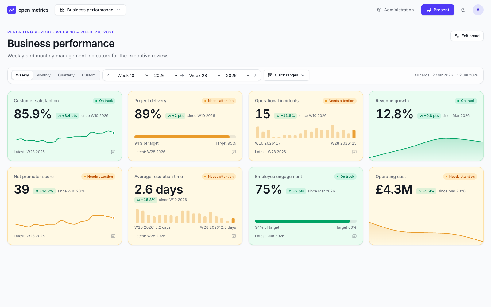

# open-metrics

A self-hosted platform for **periodic management reporting**: weekly, monthly
and quarterly metrics presented as boards of colour-coded cards with trends
and narrative commentary. It is built for review meetings and executive
presentations, not real-time monitoring.

- **Boards** – presentation pages with a responsive grid of metric cards.
- **One reporting range per board** – Weekly (ISO weeks), Monthly, Quarterly or
  a custom date range. Changing it updates every card at once. The range is
  kept in the URL, so a link or a presentation shows exactly the same period.
- **Metric cards** – latest value, change over the range, sparkline, trend
  bars, area chart or progress-to-target. Green, amber and red come from
  thresholds that respect higher-is-better and lower-is-better.
- **Narrative as data** – every observation carries its own narrative text.
  Hover a card to read the narrative history for the range; click it for the
  full history chart, the values and a comparison with the previous period.
- **Two data modes** – *managed* metrics (enter values by hand or import a
  CSV), or *external* metrics mapped from a table in an existing PostgreSQL
  database (pick the schema, table, and date/value/narrative columns, choose
  an aggregation, preview, save).
- **Presentation mode** – full screen, no administration controls, keyboard
  navigation between boards, light and dark themes, readable at 1920×1080.
- **Access control** – administrator and read-only viewer roles, Argon2id
  password hashes, server-side sessions in httpOnly cookies. Data-source
  passwords are encrypted at rest and never sent to the browser.



## Quick start (Docker Compose)

```bash
docker compose up --build
open http://localhost:8088          # admin / change-me-please
```

This starts PostgreSQL (with a sample warehouse database), runs migrations,
seeds two demo boards with 9 metrics and about 47 weeks of history, and serves
the app.

## Kubernetes / Rancher

There are two Helm charts:

| Chart | Contents |
|---|---|
| `deploy/helm/metrics-db` | PostgreSQL StatefulSet + PVC, idempotent role/database bootstrap Job, NetworkPolicy |
| `deploy/helm/metrics-app` | backend and frontend Deployments and Services, ConfigMap, Alembic migration hook Job, Ingress **or** Gateway API HTTPRoute, NetworkPolicy |

The database is a separate release because it has its own lifecycle
(upgrades, backups, storage). In production you can replace it with a managed
PostgreSQL by not installing that chart.

**Local Rancher Desktop** (`https://metrics.bupasec.com`):

```bash
deploy/scripts/deploy-local.sh
```

For a Rancher-managed cluster, see [docs/DEPLOY-RANCHER.md](docs/DEPLOY-RANCHER.md).

## Development

```bash
# backend (Python 3.12+, uv)
cd backend && uv sync && ./scripts/test.sh            # pytest against a throwaway Postgres
# frontend (Node 22)
cd frontend && npm ci && npm test && npm run dev      # Vite on :5173, proxies /api to :8080
```

## Documentation

- [docs/ARCHITECTURE.md](docs/ARCHITECTURE.md) – architecture, database schema, range semantics, screen design
- [docs/DEPLOY-RANCHER.md](docs/DEPLOY-RANCHER.md) – deploying with Helm or the Rancher UI
- [docs/CONFIGURATION.md](docs/CONFIGURATION.md) – environment variables, Secrets and Helm values
